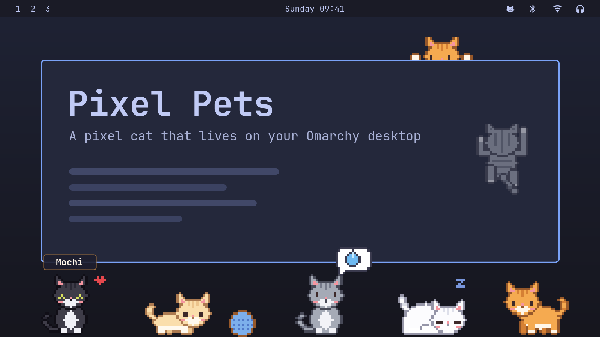

# Pixel Pets



A pixel-art cat that lives on your [Omarchy](https://omarchy.org) desktop. She walks along the bottom of the
screen, sits, naps, and stays out of your way: clicks next to her go straight through to your windows.

- **Click** her to pet her.
- **Drag** her to pick her up, let go to drop her.
- **Double-click** her to give her a ball of yarn. She chases and bats it around; you can drag and throw it too.
- Wiggle the **mouse** near the bottom of the screen and she may stalk and pounce on it.

Now and then she climbs up one of your windows (back to you, tail swinging), slips over its top edge and peeks
back over it, then climbs back down.
Click her while she peeks and she ducks; if the window closes or moves, she drops.

Between all that she grooms, yawns, and stretches after naps.

She hides under fullscreen apps.

## Care reminders

She can remind you to look after yourself. Every so often she sits down with a speech bubble asking for
**water**, **food** or a **break** (the yarn ball). Click her to give it: she drinks or eats from a bowl, or
the ball drops out for a play break. Ignore her for five minutes and she comes over to your mouse with the
bubble bouncing. Timers start over when you come back after being away (idle, locked or asleep) for five
minutes or more.

## Settings

Click the cat icon in the bar to open her settings: name, coat (orange, grey, tuxedo, white, cream),
size, energy (lazy to playful), whether she follows the time of day (lively mornings, sleepy evenings and
nights), whether she chases the mouse or climbs windows, care reminders and how often they come
(water 30-60 min, food 3-5 h, break 45-90 min), and a button to give her
a yarn ball. Right-click the icon to hide or show her. Her name pops up when you pet her.

Settings are saved in `~/.config/omarchy/pixel-pets.json`.

## Install

```sh
omarchy plugin add https://github.com/skrilexxx/omarchy-pixel-pets --enable
```

Remove with `omarchy plugin remove skrilexxx.pixel-pets`.

## Requirements

Omarchy with its Quickshell-based shell (Hyprland). No other dependencies: the pet is plain QML and PNG
sprites, and reads window and mouse positions from Hyprland's own IPC socket. She saves her settings to
`~/.config/omarchy/pixel-pets.json` and doesn't touch any other config.

## Develop

```sh
python3 tools/make_sprites.py   # redraw sprites/cat-<coat>.png (coats are in COATS)
python3 tools/make_preview.py . preview.png   # rebuild the store preview from the sprites
node tools/test_brain.js        # behaviour self-check
omarchy plugin validate .

# install the working copy (plugin folders may not be symlinks)
rsync -a --delete --exclude .git ./ ~/.config/omarchy/plugins/skrilexxx.pixel-pets/
omarchy-shell shell rescanPlugins
omarchy plugin enable skrilexxx.pixel-pets   # puts the icon in the right of the bar
omarchy restart shell           # needed after changing .qml/.js; images hot-reload, code does not
```

Layout: `Service.qml` is the pet window, input and saved settings, `Panel.qml` is the bar icon and settings
panel, `Brain.js` is the behaviour, `tools/make_sprites.py` draws the
sprite sheet (32x32 frames, one row per animation).

## License

MIT, code and art.
